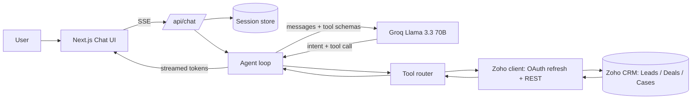

# Mahindra Multistage AI Agent Architecture

## Flow

1. The browser sends the user's message to the SSE API route.
2. The API looks up the in-memory session and starts the agent loop.
3. The model decides whether it needs to read CRM data, create records, or reply directly.
4. Tool calls are validated and routed through the Zoho helper layer.
5. Streamed assistant tokens are sent back to the client in real time.

## Notes

- The session store is intentionally in-memory for demo purposes.
- Zoho auth refresh is cached to reduce repeated refresh grant calls.
- The model is configured to stay within Mahindra-specific customer flows and to avoid creating CRM data prematurely.
